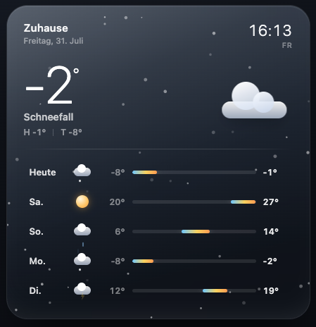

# Weather Glass Card

A frosted-glass ("Liquid Glass") weather widget for Home Assistant Lovelace dashboards. Shows current conditions, an animated weather scene, a live clock, and a multi-day forecast with min/max temperature bars — all in a translucent, iOS-style glass panel. Optionally adds small warning badges plus UV-index and pollen chips.



## Features

- Frosted-glass panel with configurable blur, saturation, and brightness shading
- Animated weather scene (sun, moon, clouds, rain, snow, fog, lightning) rendered on canvas, with `prefers-reduced-motion` support
- Automatic day/night icon switching based on `sun.sun`, for weather integrations that don't report night-specific conditions (e.g. always `sunny` instead of `clear-night`)
- Live clock and localized German date/weekday header
- Configurable 3–7 day forecast with proportional min/max temperature bars
- Dirty-checked rendering — only re-renders when the displayed data actually changes, avoiding unnecessary DOM rebuilds and animation restarts
- Visual editor support (GUI card configuration, no YAML required for the core options)
- **New:** one or more small warning badges next to the clock, each tied to a `binary_sensor` and its own tap target
- **New:** a UV-index chip, read directly off the weather entity's `uv_index` attribute
- **New:** a pollen chip showing the strongest currently-active pollen type (Pollenflug-style Gefahrenindex, 0–3 scale), with an inline warning-triangle once the index reaches "Mittel" (2) or higher
- UV/pollen chips are tappable and navigate to their own pop-up instead of the card's default more-info dialog
- Optional calm solid look (`look: solid`) for dashboards with their own animated background

## Installation

### HACS (recommended)

1. In HACS, go to **Frontend** → menu (⋮) → **Custom repositories**.
2. Add `https://github.com/donsebby/weather-glass-card` as category **Lovelace**.
3. Install **Weather Glass Card** and refresh your browser.

### Manual

1. Download `weather-glass-card.js` from the [latest release](https://github.com/donsebby/weather-glass-card/releases).
2. Copy it to `config/www/weather-glass-card.js`.
3. Add it as a dashboard resource:

   ```yaml
   resources:
     - url: /local/weather-glass-card.js
       type: module
   ```

## Configuration

| Option            | Type    | Default               | Description                                                                 |
| ------------------ | ------- | ---------------------- | ----------------------------------------------------------------------------- |
| `entity`           | string  | **required**            | A `weather.*` entity                                                        |
| `name`             | string  | entity friendly name   | Title shown top-left                                                        |
| `days`             | number  | `5`                    | Number of forecast rows to show (3–7)                                        |
| `show_clock`       | boolean | `true`                 | Show the live clock and date header                                          |
| `animations`       | boolean | `true`                 | Enable the animated canvas weather scene                                     |
| `blur`             | number  | `20`                   | Backdrop blur in px                                                          |
| `panel_shade`      | number  | `6`                    | Panel brightness; positive = lighter/whiter, negative = darker (-100–100)    |
| `look`             | string  | theme / `glass`        | `solid` switches to a calm solid panel without blur, gradients or animations, `glass` forces glass; unset = theme's `lg-look`, see *Solid look* |
| `show_uv`          | boolean | `true`                 | Show the UV-index chip (reads `uv_index` off the weather entity)             |
| `uv_navigate`      | string  | `#uv-popup`            | Hash/path the UV chip navigates to on tap                                    |
| `pollen_entities`  | list    | `[]`                   | `[{entity, label}, ...]` sensors the pollen chip picks its "strongest active type" from |
| `pollen_navigate`  | string  | `#pollen-popup`        | Hash/path the pollen chip navigates to on tap                                |
| `warning_entity`   | string  | —                      | A `binary_sensor` that shows a single pulsing warning badge next to the clock when `on` |
| `warning_icon`     | string  | `mdi:alert`             | Icon for the `warning_entity` badge (falls back to the entity's own icon)    |
| `warning_color`    | string  | `#ff9800`               | Color for the `warning_entity` badge                                        |
| `warning_navigate` | string  | `#warnungen-popup`      | Hash/path the `warning_entity` badge navigates to on tap                    |
| `warnings`         | list    | `[]`                   | `[{entity, icon, color, navigate}, ...]` for more than one warning badge — no GUI editor yet, YAML/code mode only |

### Example

```yaml
type: custom:weather-glass-card
entity: weather.forecast_home
name: Zuhause
days: 5
show_clock: true
animations: true
blur: 20
panel_shade: 6
show_uv: true
warning_entity: binary_sensor.severe_weather_warning
warning_icon: mdi:weather-lightning-rainy
warning_color: orange
warning_navigate: "#weather-warning-popup"
warnings:
  - entity: binary_sensor.lightning_warning
    icon: mdi:flash
    color: "#ffd60a"
    navigate: "#lightning-popup"
pollen_entities:
  - entity: sensor.pollen_index_birch
    label: Birch
  - entity: sensor.pollen_index_grass
    label: Grass
```

## Solid look

`look: solid` replaces the frosted glass with a calm, solid panel — meant for dashboards whose page background already shows an animated sky, so the card itself stays still:

- **Panel:** solid surface (`--surface`, default the theme's card colour at 88 %), a thin 1 px edge, `--lg-radius` corners (default 20 px), no blur, no tint/sheen gradients, no shadow. `blur` and `panel_shade` have no effect.
- **No animations inside the card:** no canvas rain/snow/fog/lightning (whatever `animations` says) and the scene and forecast icons keep still. The icons stay, drawn in flat colours without gradients or glows.
- **Chips and forecast:** UV/pollen chips and the forecast list sit on solid inner tiles (`--lg-tile-bg`); the pollen chip is tinted orange from "Mittel" on. Temperature bars are a single neutral colour.
- **Warning badges** are filled with their colour (dark icon), still pulsing while active.
- Larger, easier-to-read text (nothing below 13 px); colours follow `--primary-text-color` / `--secondary-text-color`.
- `prefers-reduced-motion` is respected.

```yaml
type: custom:weather-glass-card
entity: weather.forecast_home
look: solid
```

The visual editor offers it as *Stil: Glas / Solide*.

The look can also come from your theme, for all Liquid Glass cards at once: set `lg-look: solid` in the Home Assistant theme (the CSS variable `--lg-look`, value `solid` or `glass`). `look:` on a single card overrides the theme; without either the card stays glass. The card picks up theme switches on its own.

```yaml
# in your Home Assistant theme
lg-look: solid
```

## Notes on day/night icons

Some weather integrations never emit night-specific conditions (e.g. `sunny` both day and night). This card checks `sun.sun` and swaps the icon/tint to a night variant (moon instead of sun) when the sun is below the horizon, while leaving the text label unchanged so it still reflects exactly what the entity reports.

## Notes on warning badges vs. chips

Warning badges (`warning_entity` / `warnings`) are for alerts you want to visually stand out — they render as small pulsing circular icons next to the clock and are meant for things like severe weather or lightning warnings.

The UV and pollen chips are everyday info, not alerts, so they render as plain chips in the info row underneath the temperature instead — no pulsing. The pollen chip is the one exception: once its Gefahrenindex reaches "Mittel" (2) or higher it gets a small inline warning-triangle, without turning into a separate pulsing badge.

## Theme variables

Like the other Liquid Glass cards, this card reads two optional CSS variables, so one theme can align all of them:

```yaml
# in your Home Assistant theme
lg-radius: 22px                          # corner radius of the glass panel
lg-backdrop: blur(22px) saturate(180%)   # blur/saturation behind the panel
```

Without them nothing changes. Options set on the card itself (e.g. `blur`) still win.

## Changelog

### 1.5.1
- Solid look: the panel reads its own variables (`--lg-panel-bg`, `--lg-panel-edge`, `--lg-panel-shadow`), so a theme can style panels inside pop-ups differently from cards on the page.

### 1.5.0
- Solid look: the panel takes its fill from `--lg-tile-bg` when the theme sets it (glass solid look).
- Solid look: the card's own panel takes edge, shadow and blur from the theme (`--lg-tile-edge`, `--lg-tile-shadow`, `--lg-panel-backdrop`).
- Solid look: inner surfaces take their edge and shadow from the theme (`--lg-tile-edge`, `--lg-tile-shadow`), so a glass theme can give them a light glass edge.

### 1.4.0
- The look can come from the theme: `lg-look: solid` (CSS variable `--lg-look`) switches all Liquid Glass cards to the solid look; `look:` on the card overrides it (see *Solid look*).
- New option `look: solid`: calm solid panel without blur, gradients, glows or animations, using the optional design tokens `--surface` and `--lg-tile-bg` (see *Solid look*). Without the option the card looks exactly as before.

### 1.3.1
- Reads the optional theme variables `--lg-radius` and `--lg-backdrop` (see *Theme variables*).

## License

MIT
